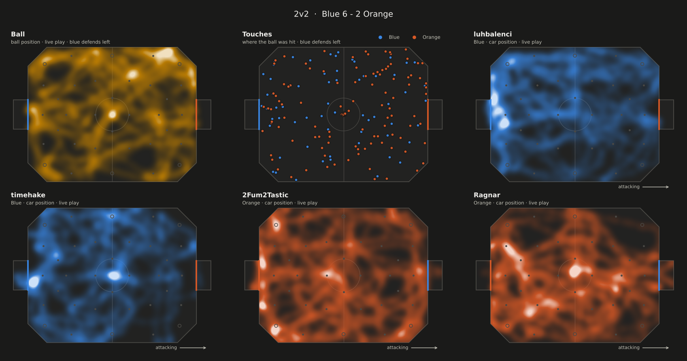
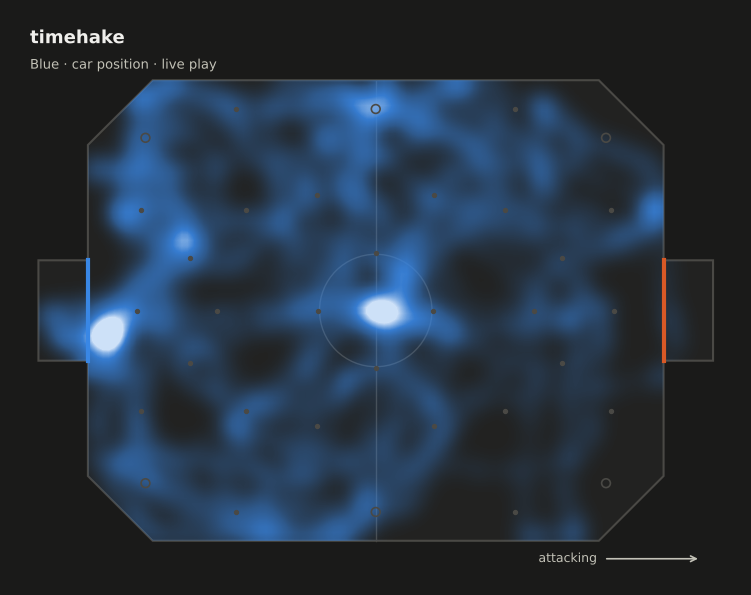
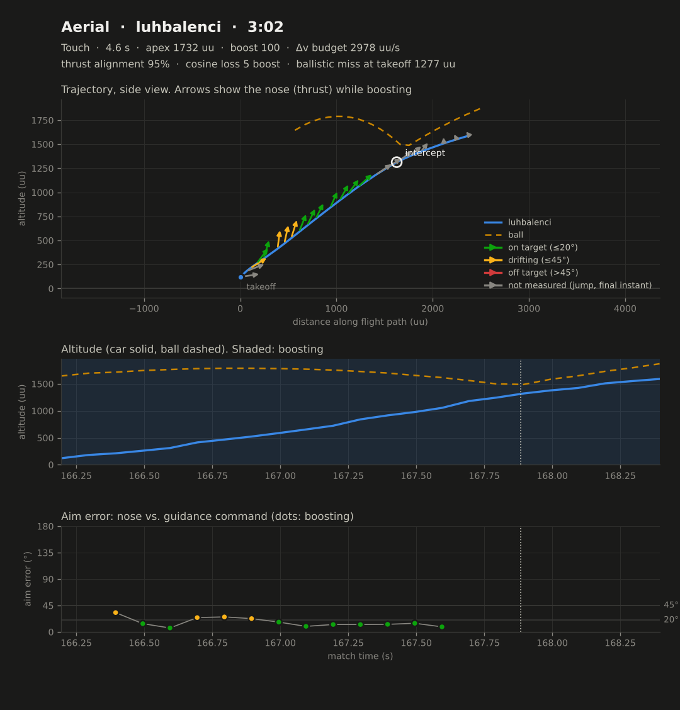
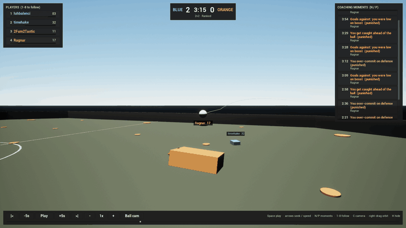
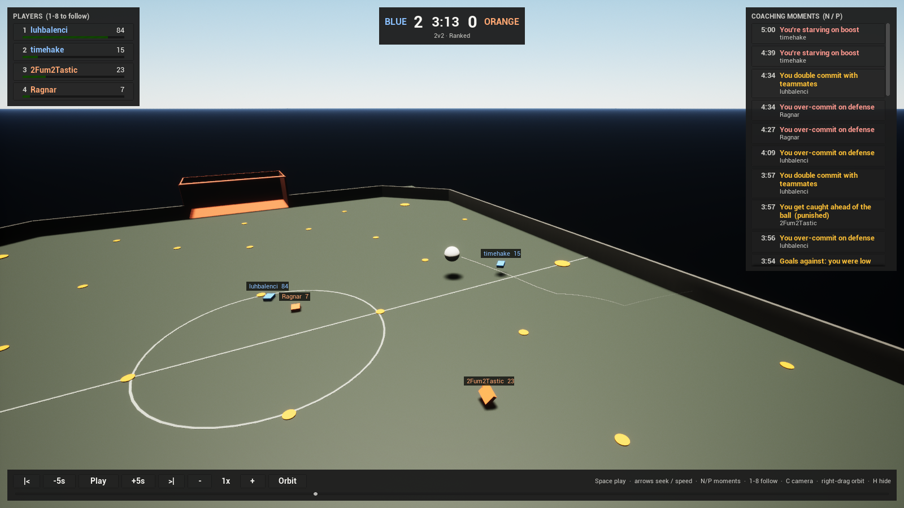
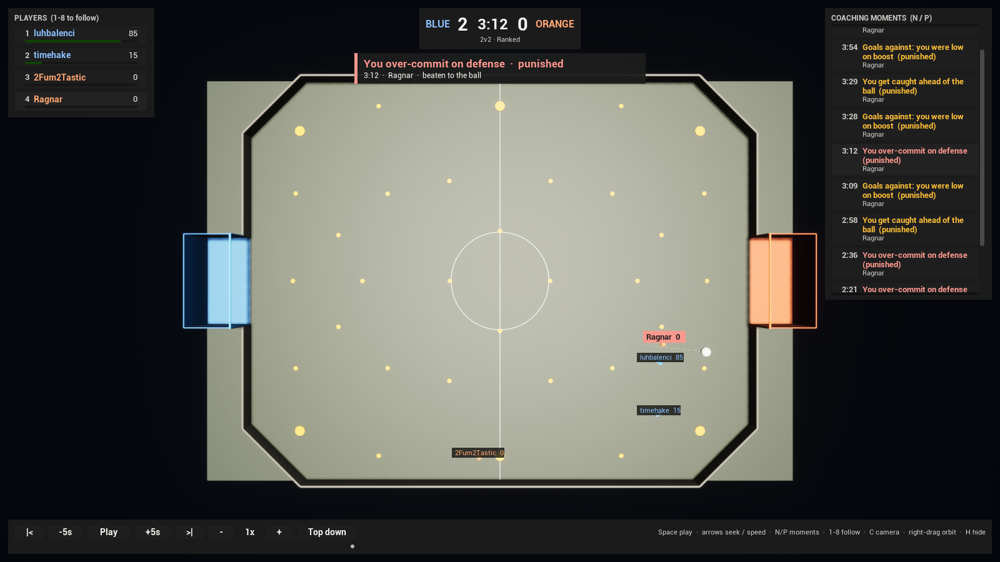

# Rocket League Analysis Tracker

Turn your Rocket League replays into stats, heat maps and coaching feedback, like
"you over-commit on defense" or "you're starving on boost". Works for 1v1, 2v2 and 3v3.

Includes a **3D replay viewer built in Unreal Engine 5 with C++** that plays
the match back and lets you jump to each coaching moment. See [`viewer/`](viewer/README.md).

> **Status:** parsing, stats, heat maps, coaching tips and the 3D viewer are done.
> The dashboard is next (see [Roadmap](#roadmap)).



## How it works

Every match you play on PC is saved as a `.replay` file. Those files contain the
full position, rotation, velocity and boost of every car and the ball, plus game
events. This project:

1. **Parses** replays with [subtr-actor](https://github.com/rlrml/subtr-actor), a
   fast Rust replay parser with Python bindings.
2. **Normalizes** the output into a typed `Match` model with tidy pandas tables.
3. **Analyzes** the match: per-player stats, heat maps, and a rule-based
   coaching engine that detects habits like over-committing, double
   committing, ball chasing and boost starvation, with timestamps. Analysis
   uses live play only, so kickoff countdowns and post-goal pauses don't skew
   the numbers.

```
.replay ──► subtr-actor ──► rltracker.parse_replay() ──► Match
                                                         ├─ ball     DataFrame (one row per frame)
                                                         ├─ cars     DataFrame (one row per frame per player)
                                                         ├─ players  scoreboard, team, platform, car
                                                         ├─ goals    time, scorer, ball speed, buildup
                                                         ├─ touches  ball/car position, role, shot type tags
                                                         └─ boost_pickups  pad type, amount, steals
```

## Install

Requires Python 3.10+.

```bash
git clone https://github.com/gilbertoHennepin/Rocket-Leaege-Analysis-Tracker.git
cd Rocket-Leaege-Analysis-Tracker
python -m venv .venv
.venv\Scripts\activate        # Windows (on macOS/Linux: source .venv/bin/activate)
pip install -e ".[dev]"
```

## Usage

### Command line

```bash
rltracker list                      # recent replays in your Demos folder
rltracker parse                     # summarize your latest match
rltracker parse --latest 5          # your last 5 matches
rltracker parse path\to\match.replay --export data   # also save tables as Parquet
rltracker parse --export data --format csv          # ...or as CSV
rltracker stats                     # boost, positioning and movement stats
rltracker stats --latest 10 --csv stats            # save as CSV too
rltracker heatmap                   # heat maps and touch maps -> ./heatmaps/<replay>/
rltracker coach                     # what to work on, with timestamps
rltracker coach --latest 5 --player "YourName"   # coach a specific player
rltracker coach --all --json reports              # every player, saved as JSON
rltracker aerials --flights         # aerials analyzed like flight test data
rltracker aerials --cards cards     # ...plus a flight test card per aerial
rltracker viewer-export             # export your latest match for the 3D viewer
```

`rltracker coach` tells you what to work on, ranked by severity, with the game
clock for each moment so you can jump to it in the replay viewer:

```
Coaching report: timehake (Blue)

  What to work on
  1. [HIGH] You're starving on boost
     You spent 52% of live play under 25 boost and 26% on empty (lobby average: 39% under
     25).
     Tip: Path through small pads when rotating back (each is worth 12), feather boost
     instead of holding it, and stop boosting once you're supersonic.
     When (clock): 5:00, 4:39, 3:54, 2:35, 1:57, 1:10 and 1 more

  2. [MEDIUM] You get caught ahead of the ball
     You were upfield of the ball for 3 opponent shots.
     Tip: Stay between the ball and your net. If you can't see the ball and your goal on
     screen together, rotate back.
     When (clock): 1:55, 1:50, 1:32

  Strengths
  + Strong defender: 4 saves.
  + Finishing: 5 goals from 5 shots.
```

By default it coaches the player who saved the replay (read from the replay
header). Set `RLTRACKER_PLAYER` to your in-game name to always pick you.

```
doubles.replay
  2v2 Ranked  ·  2026-04-28 16:00 UTC  ·  5:00
  Blue 6 - 2 Orange

  Player               Team    Score   G   A  Sv  Sh  Touches
  luhbalenci           Blue      647   1   3   2   3       36
  timehake             Blue      997   5   1   4   5       44
  2Fum2Tastic          Orange    415   0   1   1   3       70
  Ragnar               Orange    382   2   0   0   5       40

  Goals:
    3:54 left  Blue    timehake  (61 km/h)
    ...
```

`rltracker stats` prints a side-by-side comparison of every player:

```
doubles.replay  (2v2, live play only)
                              luhbalenci    timehake 2Fum2Tastic      Ragnar
                                    Blue        Blue      Orange      Orange
  Boost
    Average boost                     44          36          51          54
    Time under 25 boost              44%         52%         33%         29%
    Time on 0 boost                  21%         26%         14%          7%
    Big / small pads             22 / 66     17 / 75     31 / 61     14 / 75
  Positioning
    Defensive third                  46%         40%         39%         39%
    Behind the ball                  80%         77%         69%         64%
    Closest to ball on team          49%         51%         65%         35%
    Last back on team                57%         43%         46%         54%
  Movement
    Supersonic                       26%         13%         13%          9%
  ...
```

`rltracker heatmap` saves an overview (above) plus one image per player, the
ball and the touch map. Player maps are always drawn with that player
attacking to the right, so maps from blue and orange games compare directly.



### Aerial flight analysis

In the air, a Rocket League car is a small rocket: boost is a fixed-thrust
engine along the nose (991.7 uu/s², a thrust-to-weight ratio of 1.53 against
650 uu/s² of gravity), and air roll, pitch and yaw steer the thrust vector.
`rltracker aerials` finds every boosted aerial and measures it the way a
flight test or missile guidance engineer would:

| Measure | What it means |
| ------- | ------------- |
| **Δv budget** | The velocity change the boost you burned could buy (boost / 33.3 per s × 991.7 uu/s²). |
| **Guidance command** | The constant acceleration that carries the car from where it is to where it met the ball, at the moment it met it: the zero-effort-miss law, a = 2·ZEM / t_go². ZEM is how far you'd miss if you coasted from here. |
| **Thrust alignment** | The mean cosine of the angle between the nose and that command while boosting. 100% means every bit of thrust pushed toward the intercept. |
| **Cosine loss** | Boost spent on thrust that pointed somewhere else: boost × (1 − alignment). |
| **Ballistic miss** | The ZEM at takeoff: how far the jump alone would have missed by. It shows how much of the aerial was jump and how much was engine. |
| **Miss distance** | For aerials that never touched the ball, the closest approach. |

```
doubles.replay  (2v2, boosted aerials in live play)
                                luhbalenci    timehake 2Fum2Tastic      Ragnar
                                      Blue        Blue      Orange      Orange
    Aerials                             14           8          10          11
    Touched the ball              11 (79%)     5 (62%)     8 (80%)     7 (64%)
    Boost per aerial                    39          21          41          37
    Thrust alignment                   70%         72%         70%         66%
    Boost lost to cosine loss          142          31         115         123
    Median apex (uu)                   763         426         805         575
    Near misses                          3           2           2           3
```

`--cards` saves a flight test card for each aerial: the trajectory in side
view with the thrust vector at every boosting frame (colored by aim error),
the altitude profile with boost burns, and aim error over time. Low thrust
alignment feeds the coach ("You boost off target in the air"), and those
aerials show up as moments in the 3D viewer.



### 3D replay viewer (Unreal Engine 5, C++)

`rltracker viewer-export` writes a match to `viewer/RLReplayViewer/Replays/`.
Open the Unreal project and press Play to watch it in 3D: follow any player in
ball cam, scrub the timeline, and click a coaching moment to jump to the few
seconds before it. Build steps, controls and the architecture are in
[viewer/README.md](viewer/README.md).



| Orbit | Ball cam | Top down |
|---|---|---|
|  |  |  |

Replays are found automatically in
`Documents\My Games\Rocket League\TAGame\Demos` (including OneDrive-redirected
Documents). Set `RLTRACKER_REPLAY_DIR` to use a different folder.

### Live telemetry (UDP)

`rltracker stream` streams a match over UDP in real time, like a game server
streaming to spectators, and the viewer plays it as it arrives (start it with
`-Live`). Each packet carries a sequence number and a send time, so the
viewer measures loss, reordering and RFC 3550 jitter, drops stale frames and
smooths playback with an adaptive jitter buffer; goals and coaching moments
are made reliable by repetition. `--drop`, `--duplicate` and `--jitter-ms`
simulate a bad network to show it coping. The protocol and the design are in
[docs/telemetry.md](docs/telemetry.md).

```
rltracker stream --speed 2 --jitter-ms 40 --drop 0.05
rltracker listen        # or receive in the terminal and print link stats
```

### Python

```python
from rltracker import parse_replay

match = parse_replay("match.replay")
print(match.mode, match.score, match.winner)

me = match.player("timehake")
frames = match.player_frames(me.id)  # x, y, z, vx, vy, vz, boost, speed...
print(f"Average boost: {frames['boost'].mean():.0f}")
print(f"Time on 0 boost: {(frames['boost'] < 1).mean():.0%}")

from rltracker.stats import stats_table
from rltracker.heatmap import player_heatmap

print(stats_table(match).T)  # one column per player
player_heatmap(match, "timehake").savefig("timehake.png")
```

## Data model

Coordinates are in Unreal units (1 uu = 1 cm) with the origin at center field.
Blue defends negative `y`, orange defends positive `y`. Field constants live in
`rltracker/field.py`.

| Table / list    | Contents |
| --------------- | -------- |
| `ball`          | `frame`, `time`, `clock` (seconds left), `phase`, `live`, position, rotation, velocity, `speed` |
| `cars`          | `frame`, `time`, `player_id`, `team`, `phase`, `live`, position, rotation, velocity, `boost` (0-100), `jumping`, `speed` |
| `goals`         | `Goal`: time, team, scorer, ball position and speed, buildup type (for example `counter_attack`) |
| `touches`       | `Touch`: time, player, ball and car position, speed change, role (`first_man`...), tags (`hard_hit`, `aerial`...) |
| `boost_pickups` | `BoostPickup`: time, player, `big`/`small` pad, amount, whether it was a steal |
| `raw_events`    | the full subtr-actor event stream (rotation roles, possession, 50/50s...) for later analysis |

Frames are sampled at 10 fps by default (`parse_replay(path, fps=30)` for more detail).
`phase` is the gameplay phase (`active_play`, `kickoff_countdown`,
`kickoff_waiting_for_touch`, `post_goal`) and `live` is True during `active_play`.

## Stats

All stats come from live play. Percentages are share of live time.

| Group | Stats |
| ----- | ----- |
| Boost | average boost, time under 25 / at 0 / at 100, boost collected and used per minute, big and small pads, big pads stolen from the opponent's half |
| Positioning | time in defensive / neutral / offensive third, time behind the ball, time as closest to the ball and as last back on your team, average distance to the ball |
| Movement | average speed, time supersonic, time on the ground, time high in the air |
| Ball | touches, touches per minute, hard hits, aerial touches |

## Coaching rules

The coach first detects **moments**, then runs **rules** over each player's
stats and moments. Each rule compares against fixed thresholds and the rest of
the lobby, and counts are normalized to a 5 minute game.

| Moment | How it's detected |
| ------ | ----------------- |
| Double commit | Two teammates within 900 uu of the ball and driving at it (over 400 uu/s toward it) for at least 0.3 s. Charged to whoever was further away. |
| Lost challenge | A whiff or getting beaten to the ball (from subtr-actor's detectors) while last back on your team. In 1v1, any lost challenge. |
| Low boost stretch | 8+ seconds of live play in a row under 25 boost. |
| Caught ahead | An opponent shot taken while you were 300+ uu upfield of the ball. |
| Goal conceded | Your boost and position at the moment of the shot that scored. |

A moment is **punished** if the opponent shot or scored within 5 seconds.

| Rule | Fires when |
| ---- | ---------- |
| Starving on boost | 40%+ of live play under 25 boost (high at 50%+) |
| Over-committing | 3+ lost last-man challenges per 5 min, or 2+ that got punished |
| Double committing | 4+ double commits per 5 min, or 2+ that got punished (team modes) |
| Ball chasing | closest to the ball 12+ points above an even split, and behind the ball under 72% (team modes) |
| Caught ahead of the ball | 3+ opponent shots while upfield, or behind the ball under 65% |
| Goals-against pattern | low on boost, or ahead of the ball, for most of the goals conceded |
| Boosting off target in the air | thrust alignment under 60% and 5 points below the lobby, over 4+ aerials (see [Aerial flight analysis](#aerial-flight-analysis)) |
| Sitting on full boost, big pad reliance, slow play, playing too deep | lower-priority habits, see `coach.py` |

Strengths (good boost management, disciplined positioning, most involved
player, and so on) are reported too, so the feedback isn't all negative.

## Project layout

```
src/rltracker/
  parser.py      replay file -> Match
  models.py      Match, Player, Goal, Touch, BoostPickup, Team
  field.py       field dimensions and unit conversions
  discovery.py   find replay folders and files
  stats.py       per-player stats from live play
  heatmap.py     field diagram, heat maps, touch maps
  moments.py     detect double commits, lost challenges, low boost stretches...
  coach.py       coaching rules, strengths and reports
  aerial.py      aerial detection and flight analysis (guidance, thrust alignment)
  flightcard.py  flight test card figures
  rotation.py    quaternions and nose vectors from the parser's Euler angles
  export.py      save a Match as Parquet/CSV + match.json
  viewer_export.py  export a Match for the 3D viewer
  telemetry.py   live UDP telemetry: the RLT1 protocol, sender and listener
  cli.py         the rltracker command
tests/           pytest suite, run against real 1v1, 2v2 and 3v3 replays
viewer/
  RLReplayViewer/  Unreal Engine 5 C++ project (3D replay viewer)
  core-tests/      CMake unit tests for the viewer's engine-free playback and telemetry core
```

## Development

```bash
pytest          # tests
ruff check .    # lint
ruff format .   # format
```

CI runs the tests on Windows and Linux for Python 3.10 and 3.13, and builds
and runs the viewer's C++ core tests with CMake (MSVC and GCC, warnings as errors).

```bash
cmake -S viewer/core-tests -B build/core-tests
cmake --build build/core-tests && ctest --test-dir build/core-tests
```

## Roadmap

- [x] **1. Replay parser and data model**: parse 1v1/2v2/3v3 replays into tidy tables
- [x] **2. Stats and heat maps**: boost usage, time starved on boost, positioning by third, car and ball heat maps
- [x] **3. Tactical analysis**: detect over-commits, double commits, ball chasing, poor rotation, with timestamped tips
- [x] **Aerial flight analysis**: boosted aerials measured with guidance and flight test methods
- [x] **3D replay viewer**: Unreal Engine 5 C++ playback with cameras and a clickable coaching timeline
- [x] **Live telemetry**: stream a match over UDP into the viewer, with loss, jitter and a playout buffer
- [ ] **4. Dashboard**: per-match reports and trends over many games

## Credits

Replay parsing by [subtr-actor](https://github.com/rlrml/subtr-actor) (MIT).
Test replays are from its test assets; see `tests/fixtures/README.md`.

## License

MIT
