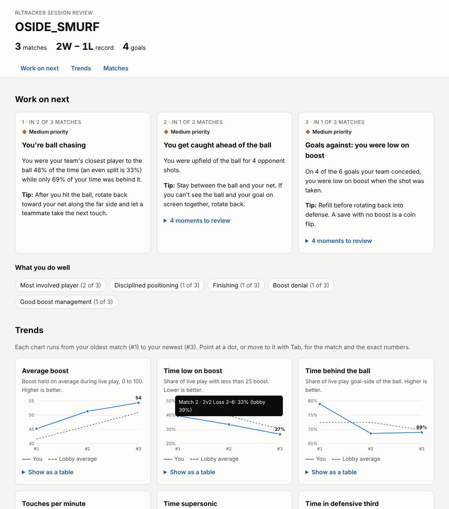

# Session dashboard: design notes

`rltracker dashboard` writes one HTML page about your recent matches. This
document explains who it is for, the design decisions behind it, how its
accessibility is checked, and how its usability would be tested.

```
rltracker dashboard                     # your last 10 replays
rltracker dashboard --latest 25 --player "YourName" --out review.html
```



## Who it's for

A player who has just finished a session of ranked games. They open the page
for a few minutes and want three answers: **what should I work on next, am I
getting better, and what happened in that game I lost?** They know Rocket
League well (boost, rotation, "ball chasing") but not statistics, and they
won't read a manual.

The command-line reports (`rltracker coach`, `stats`) already have all the
numbers. The dashboard's job is to decide what matters, show it in that
order, and leave the rest one click away.

## Design decisions

| Decision | Why (principle) |
|---|---|
| The page opens with **at most three focus areas**, ranked by how many matches they came up in, then by severity. | Too many priorities and there are none. Ranking by recurrence favours habits over one bad game. Hick's law and cognitive load. |
| Each focus area says what happened, why it matters, and **one concrete tip**, in the game's own words ("rotate back toward your net along the far side"). | Match between the system and the real world (Nielsen #2). Coaching that can be acted on, not a score. |
| Moments are listed by **game clock** ("3:41"), the time the replay shows, and link to that match. | Recognition rather than recall (Nielsen #6). The player can find the play in the in-game replay viewer or in the 3D viewer. |
| Strengths are shown too, under "What you do well". | Feedback that is only negative is discouraging and less likely to be used. |
| Trends are **small multiples**: one stat per chart, each on its own scale, with the lobby average as a dashed reference line. | Comparing values across charts with different units on one dual-axis chart misleads. The lobby line answers "is 45 boost good?". |
| Every chart says whether **higher or lower is better**, and stat tables say "Better than the lobby" in words. | Direction isn't obvious for stats like "time low on boost". Meaning never relies on color alone (WCAG 1.4.1). |
| Detail is behind native `<details>` disclosures: the moment list and each chart's data table. | Progressive disclosure keeps the first screen scannable. Native elements are keyboard and screen-reader accessible by default. |
| Severity uses a **shape and a word** (▲ High, ◆ Medium, ● Low priority); results use ✔ Win / ✖ Loss. | Color-blind users and grayscale printouts get the same information. |
| The page is **one self-contained file**: inline CSS, a few lines of JS, heat maps embedded as PNG. | It opens offline, can be emailed or put in a Discord channel, and has no tracking or third-party requests. |
| Your team's score is always written first ("Loss 2–6"). | That's how players say it. Consistency (Nielsen #4). |
| Matches are numbered #1 (oldest) to #N on charts, tables and links. | Several matches on one day have the same date, so dates don't tell them apart. |

## Accessibility (WCAG 2.2 AA)

| Requirement | How the page meets it | How it's checked |
|---|---|---|
| Text contrast ≥ 4.5:1, graphics and focus rings ≥ 3:1 (1.4.3, 1.4.11) | Light and dark palettes are defined as color tokens. Text is only ever in the text tokens, never in series colors. | `test_colors_meet_wcag_aa` computes the WCAG contrast ratio of every text and mark pair in both themes. |
| Not color alone (1.4.1) | Severity badges carry a word, results carry ✔/✖ and a word, lines differ by dash pattern as well as color, comparisons are written out. | `test_page_is_accessible_and_self_contained`. |
| Text alternatives (1.1.1) | Each heat map's alt text gives the share of time in each third of the field. Each chart is a labelled group whose points have labels, plus a data table with the same numbers. | Tests check every `img` has alt text and every chart has a table. |
| Keyboard (2.1.1, 2.4.7) | Skip link, then every link, disclosure and chart point is reachable with Tab. Points show their tooltip on focus; Escape hides it. Visible 3 px focus ring. | Tests check every focusable element has a label. Checked by hand. |
| Structure (1.3.1, 2.4.6) | One `h1`, headings that never skip a level, landmarks (`header`, `nav`, `main`, `footer`), tables with `th scope` and captions, `lang="en"`. | Tests check the heading order and `lang`. |
| Reflow (1.4.10) | The grid collapses to one column. No horizontal scrolling at 320 CSS px, except the wide match table, which scrolls inside its own box. | Rendered at 390 px wide in Chromium: page width stays 390. |
| Target size (2.5.8) | Chart points have a hit area of about 28 px around an 8 px dot. Clock-time chips are at least 32 px tall. | By construction. |
| Motion and user settings | Smooth scrolling only with `prefers-reduced-motion: no-preference`. Follows `prefers-color-scheme`. Forced-colors mode keeps the chart lines. | Rendered in light and dark. |
| Untrusted text | Player names come from replay files and are HTML-escaped everywhere. | `test_player_names_are_escaped`. |

An automated audit with [axe-core](https://github.com/dequelabs/axe-core)
4.10 (WCAG 2.0/2.1/2.2 A and AA rules plus best practices) reports **no
violations** on the 3-match and 1-match pages, in light and dark mode. Axe
covers only part of WCAG, which is why the keyboard and structure checks above
also exist.

## Usability test plan

A small think-aloud study, enough to find the big problems (five participants
find most of them).

**Participants.** Five Rocket League players, ranked Gold to Champion, a mix
of 2v2 and 3v3 players, at least one who is color-blind or uses a screen
reader if possible. Each uses a dashboard made from their own last 10
replays.

**Tasks**, read aloud one at a time:

1. "What is the one thing this page says you should practice next?"
2. "Find a moment in a game where that happened, and tell me the clock time."
3. "Is your boost management getting better or worse over these games?"
4. "Find the game you lost by the most. What went wrong in it?"
5. "Using only the keyboard, open the data table for 'Time behind the ball'."

**Measures.**

- Task success (yes / with help / no).
- Time on task.
- Errors, such as reading a trend backwards or confusing the lobby line with their own.
- The System Usability Scale (SUS) questionnaire at the end.
- One open question: "What would you change?"

**What would count as success.**

- Tasks 1 to 3 completed without help by at least 4 of 5 participants, in under a minute each.
- A mean SUS score above 68, the published average.
- Any task that two or more participants fail gets a redesign before anything else is added.

Results go in this document when the study has been run.
