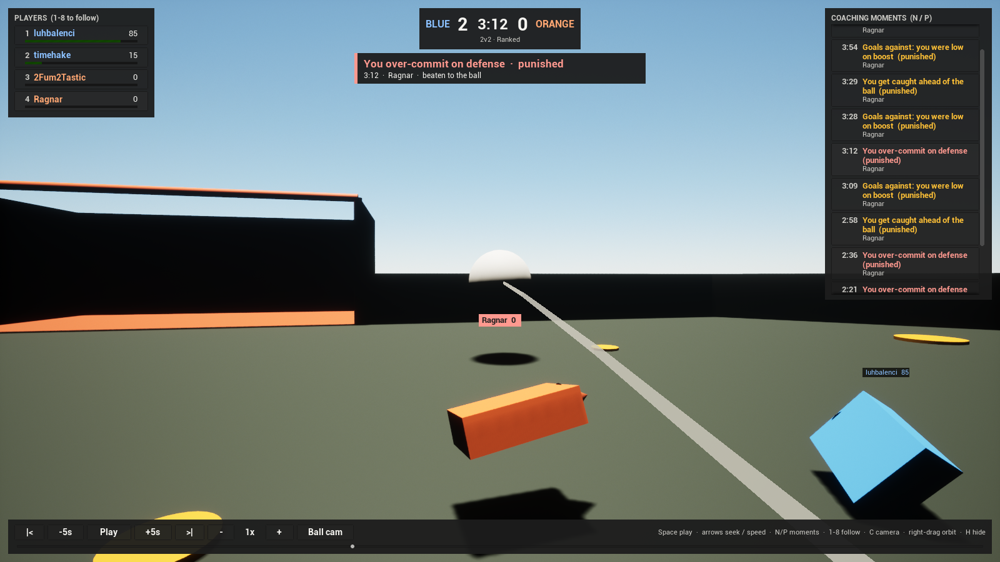

# RL Replay Viewer (Unreal Engine 5, C++)

A 3D replay viewer for matches analyzed by `rltracker`. It plays back the ball
and every car in a to-scale arena, and puts the coaching engine's moments
("double commit", "starving on boost", ...) on a clickable timeline, so you can
jump straight to the play a tip is about and watch it from the player's camera.

Everything is C++: the arena, cars, cameras, playback and the on-screen UI
(Slate) are built in code from the engine's basic shapes. The project has no
Blueprints and no binary `.uasset` files, so every change is reviewable in a
diff.



## Build and run

Requirements: **Unreal Engine 5.5 or newer** (Epic Games Launcher), plus
**Visual Studio 2022** with the "Game development with C++" workload on Windows,
or **Xcode** on macOS.

1. Export one or more matches from the repo root:

   ```bash
   rltracker viewer-export                      # your latest replay
   rltracker viewer-export --latest 5           # your last 5
   rltracker viewer-export path\to\match.replay
   ```

   Files are written to `viewer/RLReplayViewer/Replays/<replay>.rlview.json`.

2. Right-click `viewer/RLReplayViewer/RLReplayViewer.uproject` and choose
   **Generate Visual Studio project files**. (If the menu item is missing,
   open the `.uproject` with UE 5.5 once and it will offer to build.)
   On macOS, choose **Services > Generate Xcode Project** instead, or build
   from Terminal (see below).
3. Open `RLReplayViewer.sln`, set the configuration to **Development Editor**,
   and build (Ctrl+Shift+B).
4. Open the `.uproject` and press **Play**. The newest export loads
   automatically; pick others from the **Matches** list.

To open a specific file, launch with `-RLReplay="C:/path/to/match.rlview.json"`.

To watch a match live, launch with `-Live` (or click **Listen for a live
match**) and run `rltracker stream`. The match streams over UDP and plays as
it arrives; see [docs/telemetry.md](../docs/telemetry.md). Add
`-LiveCapture="/abs/folder"` to have it save screenshots of live mode by itself
and log the link stats and playback smoothness every second, then quit.

To run the automation tests in the editor: **Tools > Session Frontend >
Automation**, filter `RLReplayViewer`, run.

## Controls

| Input | Action |
| ----- | ------ |
| Space | Play / pause |
| Left / Right | Back / forward 5 seconds |
| Up / Down | Faster / slower (0.25x to 4x) |
| N / P | Next / previous coaching moment |
| 1-8 | Follow a player in ball cam |
| 0 | Free camera |
| C | Cycle camera: orbit, ball cam, top down |
| Right-drag, W A S D | Orbit the camera |
| Mouse wheel, E / Q | Zoom |
| L | Jump to the live edge (live mode) |
| H | Hide the HUD |

Everything is also clickable: players (with live boost bars), the coaching
moments list, transport buttons, speed, camera mode and the timeline slider.

## How it works

```
.replay ─► rltracker (Python) ─► <replay>.rlview.json ─► Unreal viewer (C++)
            parse, stats, coach    frames + moments        load, interpolate, render
```

| File | Role |
| ---- | ---- |
| `Core/ReplayCore.h` | Engine-free math: vectors, quaternions, slerp, frame lookup and interpolation, the playback clock, moment navigation and camera poses. Unit tested with CMake in `../core-tests` (and in CI on Windows and Linux). |
| `RLReplayData` | JSON loader for the export format, with validation (format, version, array lengths). |
| `RLReplayDirector` | Owns the match and the clock, moves ball and car meshes every frame, draws the ball trail. In live mode it also follows the live edge. |
| `RLArena` | Field, walls, goals and all 34 boost pads, built from basic shapes. |
| `RLViewerPawn` | Orbit, ball cam and top down cameras, with smoothing. All keyboard and mouse input. |
| `SRLReplayHud` | The Slate UI. |
| `RLViewerGameMode` | Spawns lighting, arena, director and HUD, and picks which replay to open (or starts live mode). |
| `Core/TelemetryCore.h` | Engine-free live mode: the RLT1 packet parser, the receiver rules (one stream, duplicates, stale frames, repeated events), RFC 3550 jitter and loss, and the playout buffer. Unit tested in `../core-tests` with the same golden packet as the Python side. |
| `RLTelemetryReceiver` | The UDP socket, read on a background thread that stamps each datagram's arrival time. The director drains it every frame and appends the frames to the match, so live playback, scrubbing and moments use the same code as a file. |

**Data format.** Frames are sampled at 10 fps and stored as flat arrays
(`pos` = x0, y0, z0, x1, ... and `rot` = quaternion x, y, z, w per frame) so a
5 minute 2v2 is about 1 MB. The viewer interpolates between frames (linear for
position, slerp for rotation), so playback is smooth at any frame rate and
speed.

**Coordinates.** Rocket League runs on Unreal Engine 3 and its replays use
Unreal units (1 uu = 1 cm) and Unreal's axes, so positions and quaternions are
used as they are, with no conversion. The parser reports rotations as Euler
angles; `rltracker.viewer_export.euler_to_quat` rebuilds the original
quaternions, and a test checks that the rebuilt car orientation points along
the car's velocity.

## Status

The Python export and `ReplayCore.h` are tested automatically in CI. The
Unreal project has been built on macOS with UE 5.8 and Xcode; CI can't build
it because that needs an engine install.

To build from a terminal on macOS:

```bash
"/Users/Shared/Epic Games/UE_5.8/Engine/Build/BatchFiles/Mac/Build.sh" \
  RLReplayViewerEditor Mac Development \
  -Project="$PWD/viewer/RLReplayViewer/RLReplayViewer.uproject" -WaitMutex
```
